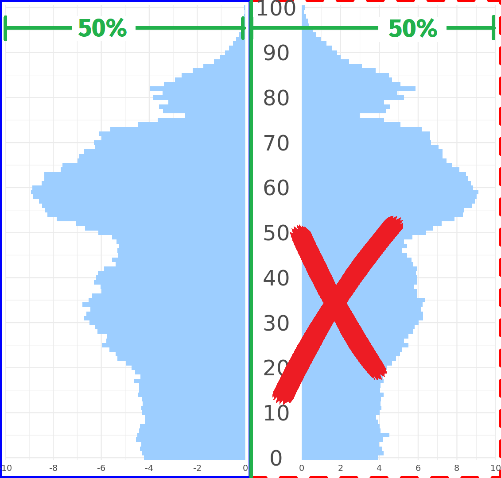
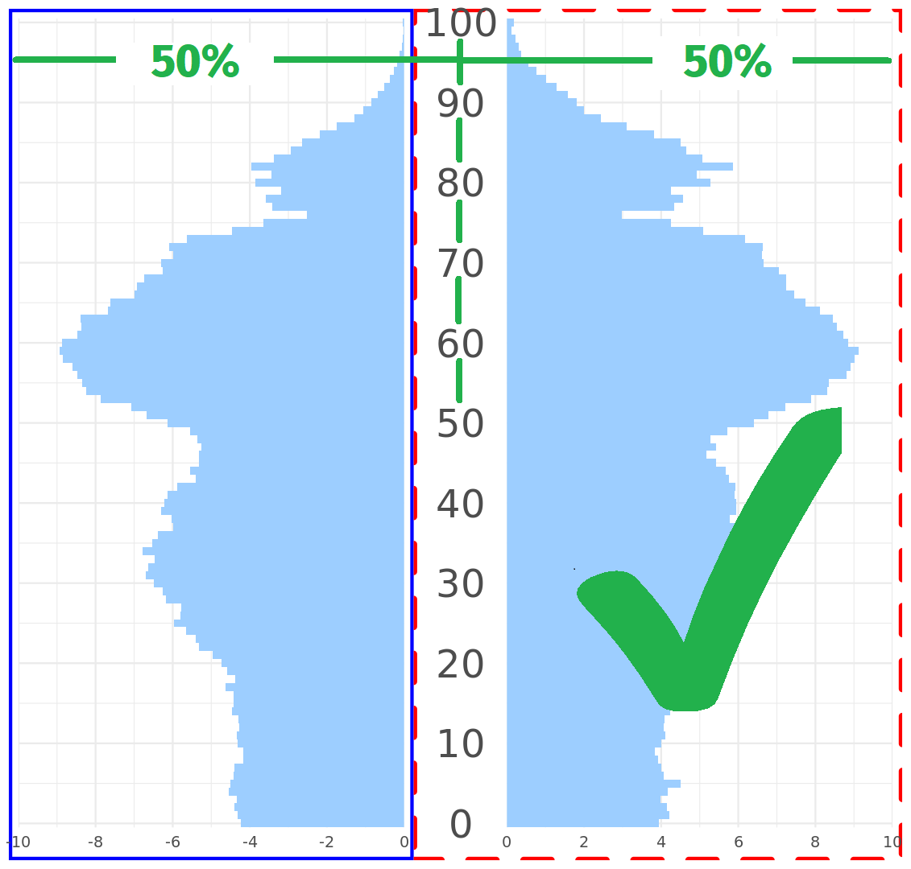
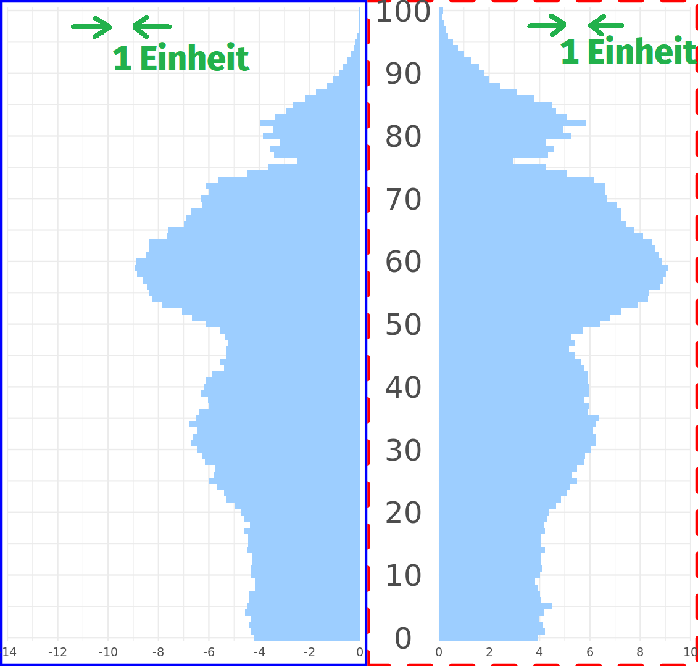
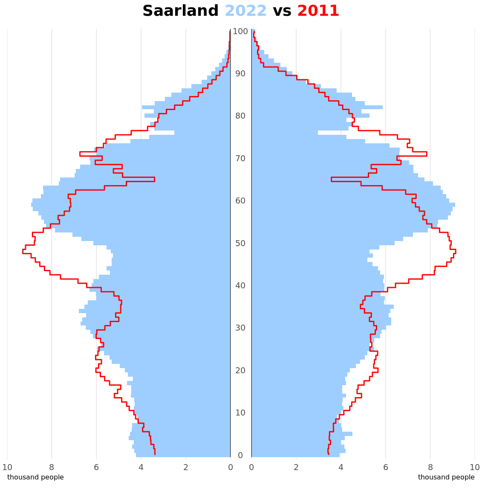
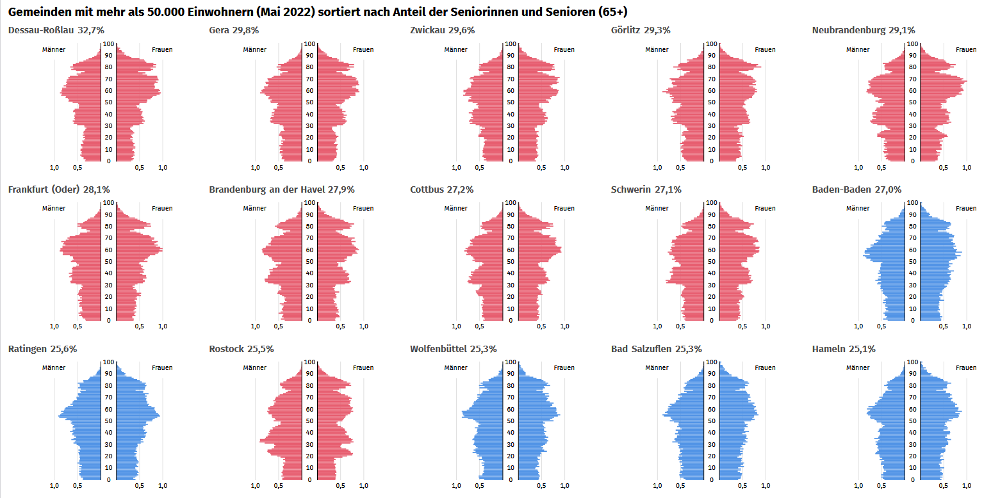
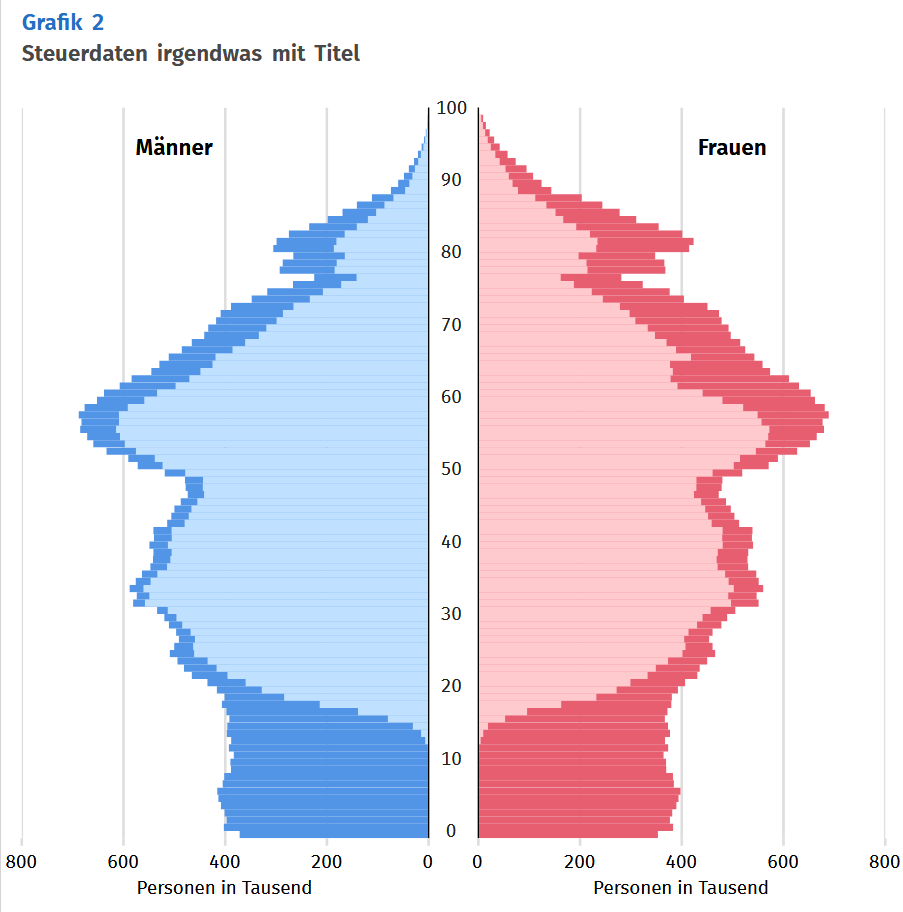

# Creating population pyramids in less than 100 lines of code

The Use of R in Official Statistics – conference 18-20 November 2026  
https://r-project.ro/conference2026.html

### Where are the pitfalls?

Run the code examples in their numerical order and keep an eye on the x-scales for men and women

### Some screenshots show the results  

<table>
  <tr>
    <td><code>grid.arrange</code> </td>
    <td><code>patchwork</code> </td>
    <td><code>gtable</code> </td>
  </tr>
</table>  
  
#### Outlines for Timeseries  
  

  
  
#### Small Multiples  
  

  
  
#### Sub-Population  
  

    
